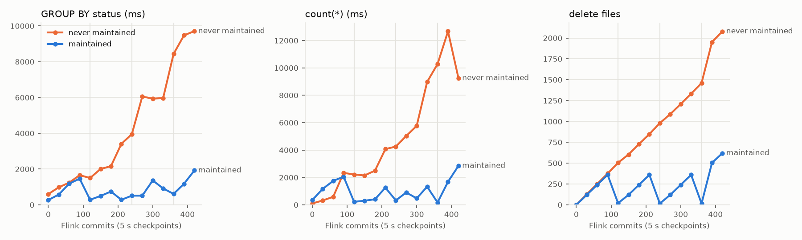

# cdc-lakehouse

## TL;DR

Streams insert, update and delete ops from a Postgres database into Apache Iceberg tables that Trino can query within about 30 seconds. While copying is cheap, the project is about keeping the copy true-to-source while parts of the pipeline crash, so there is a chaos suite that kills components while the pipeline runs and then compares Iceberg rows with Postgres rows.

- A total of **12 injected faults across 9 scenarios with no wrong rows afterwards.** (A replay with the guard 'off' gave 994 wrong rows.)
- **95% of postgres rows land within 30.4 s from Postgres commit.** Query-able in Trino at 30 s checkpoints, capture takes half a second (the rest is waiting for the next checkpoint).
- Everything run on docker.

<div style="overflow-x: auto; white-space: nowrap;">
  
| Component | What is its use in the setup |
|:---|:---|
| Postgres 16 | the source; changes are read from its WAL log through a replication slot |
| Debezium 3.7 on Kafka Connect | turns each committed row change into an event |
| Kafka 4.2 + Schema Registry | keeps the events in order per row and replayable, with Avro schemas checked for compatibility |
| Flink 1.20 job (Java) | decodes events, drops stale or duplicate ones, upserts into Iceberg in one commit per checkpoint |
| Iceberg 1.12 on S3 (MinIO) | the analytics tables, with snapshots and time travel |
| Trino 484 | SQL over the tables, and the compaction jobs |
| Controller in Python | creates and evolves tables from Schema Registry, stops on unsafe changes, restarts the job and failed connector tasks |
| Prometheus + Grafana | Dashboard, Alerts, and Runbooks |

</div>

The Flink job, controller, chaos suite, and the benchmarks were written; and the rest is configuration.

<div style="overflow-x: auto; white-space: nowrap;">
 
| Adversarial event | What the pipeline does | Test|
|:---|:---|:---|
| Flink worker crashes | restarts from its last checkpoint, no loss or something written twice | 5 kill actions wtih 2 of them between a checkpoint and its Iceberg commit |
| Flink JobManager dies | the controller waits out the old job, then resubmits from the newest checkpoint in S3 | resumed from checkpoint 33 |
| Debezium is killed | resumes from its last saved offset; the guard drops what it re-sends | 360 events re-sent with no wrong rows |
| Kafka or S3 goes down | everything retries and waits and the controller restarts failed connector tasks with backoff | Kafka was down 60s, S3 was paused 150 s |
| Old events get replayed | the guard drops anything not newer than what that row already has | 2100 replayed and the same were dropped |
| Message with an invalid Avro key lands on a topic | gets parked in a dead letter topic, the alert fires, and the pipeline keeps going | 1 record in the DLQ |
| A table or column is added, or a type enlarged | the controller changes the Iceberg table and restarts the job and the new defaults get backfilled | 3 DDL steps abd the rows match |
| Small files pile up | hourly compaction, snapshot expiry and orphan cleanup | 9.7 s queries when unmaintained, 0.6 s after compaction |

</div>

The test harness restarts each killed container after 3 to 60 s, standing in for an orchestrator. From there, recovery takes no human step.

Some things stop the pipeline on purpose:
- Column renames and drops stop the pipeline with an alert for a human to take action on.
- Non decoded row changes (skipping it would lose data).
- TRUNCATE statements.
- A primary key type change or a decimal scale change.

While stopeed, events wait in Kafka. If Debezium stays down, Postgres keeps the WAL it needs, with an alert at 1 GB and a 4 GB cap so the source can't fill its disk; past the cap the tables need a rebuild.


## Architecture

```
Postgres 16 ──pgoutput──> Debezium 3.7 (Kafka Connect) ──Avro──> Kafka 4.2 + Schema Registry
                at least once, per-key order                           │
                                                                       │ offsets, guard state and pending
                                                                       │ commits in one checkpoint
                                                                       v
Trino 484 <── Iceberg 1.12 on S3, REST catalog <──one commit per checkpoint── Flink 1.20 job
                                                                               decode > keyBy(pk) > guard > upsert
                                                                               every Kafka record > changelog table
controller: creates and evolves tables from Schema Registry, resubmits the job from its newest checkpoint, restarts failed connector tasks
```

## Running it

Needs Docker with about 8 GB of memory for the VM and about 12 GB of disk for images. Everything else builds in containers, so there is no local Java or Python setup.

```
make up          # build the Flink job and images, start the stack, wait until healthy
make seed        # bulk-load the shop, register Debezium (initial snapshot), reconcile
make chaos       # failure scenarios under load, each followed by a full reconcile
```

Other targets: `make load` (steady workload with latency probes), `make reconcile`, `make evolve` (schema change suite; run it on a fresh stack, it ends with one table halted on purpose), `make bench-latency`, `make bench-maintenance`, `make maintain`, `make upgrade` (rebuild the job and restart it through a savepoint), `make report` (rewrites the tables below from `results/`), `make trino`, `make reset`.

UIs: Flink `localhost:8081`, Trino `localhost:18080`, Grafana `localhost:3000`, Prometheus `localhost:9090`, MinIO `localhost:9001`.

## Results

### Failure injection

`make reset && make up && make seed && make chaos` ran unattended in 58 minutes on an M-series MacBook with 7.6 GiB for the Docker VM. During every scenario the generator runs at 100 ops/s. The load covers inserts, order status updates, cascading deletes, and price updates on products whose 4.8 KB descriptions Postgres stores out of line (TOAST). It also includes primary key updates, a 300 to 600 row transaction every two minutes, and one latency probe per second. Every scenario ends with the drain and every check listed under "How correctness is checked". "Fault held" is how long the component was down or paused. "Fresh data after heal" is the time from the component coming back until a probe row written at that moment was queryable in Trino. Raw output is in `results/chaos/`.

<!-- chaos -->
| scenario | runs | fault held | evidence the fault landed | row diffs | version regressions | fresh data after heal | worst latency | result |
|---|---|---|---|---|---|---|---|---|
| tm-kill-during-checkpoint | 3 | 5 s | chk 2 failed, restored 1; chk 6 failed, restored 5; chk 10 failed, restored 9 | 0 | 0 | 35 s | 68 s | pass |
| tm-kill-before-iceberg-commit | 2 | 3 s | chk 20 committed 1x; chk 25 committed 1x | 0 | 0 | 47 s | 57 s | pass |
| jobmanager-kill | 1 | 10 s | resumed from chk-33 | 0 | 0 | 67 s | 87 s | pass |
| kafka-broker-kill | 1 | 60 s | 3561 events re-sent after the outage | 0 | 0 | 48 s | 102 s | pass |
| connect-sigkill | 1 | 10 s | 360 events re-sent | 0 | 0 | 40 s | 49 s | pass |
| minio-pause-150s | 1 | 150 s | no commits during pause, 1 checkpoint(s) failed | 0 | 0 | 19 s | 183 s | pass |
| replay-old-offsets | 1 | - | 2100 old records re-produced, 2100 dropped | 0 | 0 | - | 32 s | pass |
| poison-record | 1 | - | 1 record in DLQ | 0 | 0 | - | 31 s | pass |
| compaction-under-load | 1 | - | orders ok, order_items ok, payments ok | 0 | 0 | - | 33 s | pass |
| control-replay-without-guard | 1 | - | 2100 old records re-produced, 0 dropped | 994 | 904 | - | 32 s | fails as expected; incremental snapshot left 131 diffs, deleting 131 resurrected keys left 0 |
<!-- /chaos -->

### Latency

`make bench-latency`: 10 minutes at 100 ops/s for each checkpoint interval, with one probe row per second. Latency is the commit time of the first Iceberg snapshot that contains the probe, minus the probe's Postgres commit timestamp (`track_commit_timestamp`). Both clocks are inside the Docker VM, and there is no polling error, because each snapshot is read with time travel. Most of the time is spent waiting for the next checkpoint, so p95 should sit near the interval plus commit time, and it does.

<!-- latency -->
| checkpoint | probes | p50 | p95 | p99 | Postgres to Kafka p50 | Kafka to Iceberg p50 |
|---|---|---|---|---|---|---|
| 10 s | 598 | 6.6 s | 11.1 s | 11.8 s | 0.51 s | 6.1 s |
| 30 s | 599 | 17.1 s | 30.4 s | 31.7 s | 0.49 s | 16.5 s |
| 60 s | 599 | 32.2 s | 59.2 s | 61.5 s | 0.50 s | 31.9 s |
<!-- /latency -->

### Schema changes

`make evolve` runs DDL against the live pipeline, one statement at a time, on a fresh `make reset && make up && make seed`. Each step records what happened and applies the resolution from [the runbook](docs/runbooks/pipeline-halted.md). It then reconciles that table against Postgres. "Expected" is what I predicted before the first run.

Two steps behaved differently from that prediction, and both are worth knowing:
- The rename went through both gates. `full_name` is NOT NULL, so the renamed field is required and has no default, and Schema Registry rejected it. Once that subject was relaxed, the controller saw a removed column and halted until the Iceberg rename.
- The decimal scale change passed Schema Registry, because to Avro both versions are bytes. Only the controller stopped it.

`ADD COLUMN ... DEFAULT 'bronze'` matches Postgres on every old row, because the controller requested an incremental snapshot to backfill them.

<!-- evolution -->
| DDL | expected | observed | resolution | job restarts | rows match |
|---|---|---|---|---|---|
| `ALTER TABLE orders ADD COLUMN priority smallint` | applied | applied | - | 1 | yes |
| `ALTER TABLE customers ADD COLUMN loyalty_tier text NOT NULL DEFAULT 'bronze'` | applied | applied | - | 1 | yes |
| `ALTER TABLE order_items ALTER COLUMN quantity TYPE bigint` | applied | applied | - | 1 | yes |
| `ALTER TABLE order_items ALTER COLUMN quantity TYPE integer` | applied | applied | - | 0 | yes |
| `ALTER TABLE order_items ALTER COLUMN quantity TYPE smallint` | rejected | rejected by schema registry | compatibility NONE for the subject | 1 | yes |
| `ALTER TABLE customers RENAME COLUMN full_name TO display_name` | halted | rejected by schema registry then halted | compatibility NONE for the subject, then make schema-resolve rename full_name display_name | 1 | yes |
| `ALTER TABLE products DROP COLUMN description` | halted | halted | make schema-resolve drop description | 1 | yes |
| `ALTER TABLE payments ALTER COLUMN amount TYPE numeric(12,4)` | halted | halted | left halted: Iceberg cannot change a decimal scale | - | - |
<!-- /evolution -->

### Compaction

`make bench-maintenance` compresses time. One job writes the same stream to `orders` and to `orders_raw`, and both start from the same compacted copy. Checkpoints run every 5 s under 200 ops/s, which gave 420 commits in an hour at 681 rows per commit. Every 120 commits, `orders` gets Trino `optimize`, `optimize_manifests` and `expire_snapshots`; `orders_raw` never does. At the default 30 s interval, 120 commits is one hour and 420 is three and a half; rows per commit would be about four times higher, but the number of files per commit is the same. Query times are medians of five runs, taken with the metrics exporter paused. Vertical lines mark maintenance runs.

Read cost follows the delete-file count, not the row count. Each commit added about 7 files: per writer, one data file plus equality and position deletes. That is roughly 21,000 files per table per day at 30 s checkpoints if nothing compacts them. Before the bounded heap (see the notes below), the unmaintained table killed Trino at about 170 commits.

<!-- maintenance -->


| | start | never maintained, 420 commits | maintained, right after the run at 360 | maintained, 420 commits |
|---|---|---|---|---|
| GROUP BY status, ms | 602 | 9712 | 612 | 1928 |
| count(*), ms | 103 | 9255 | 174 | 2849 |
| point lookup, ms | 280 | 9465 | 499 | 2280 |
| data files | 1 | 1041 | 9 | 311 |
| delete files | 0 | 2080 | 16 | 620 |
<!-- /maintenance -->

### Footprint

Peak memory per container, sampled every minute during `make chaos`. Trino reaches its limit, because the 896 MB heap plus native memory and page cache fill the container. It did not restart during the run.

<!-- footprint -->
| container | peak during chaos | limit |
|---|---|---|
| taskmanager | 1591 MiB | 1800 MiB |
| trino | 1533 MiB | 1536 MiB |
| jobmanager | 729 MiB | 896 MiB |
| connect | 622 MiB | 768 MiB |
| kafka | 401 MiB | 512 MiB |
| schema-registry | 328 MiB | 448 MiB |
| prometheus | 225 MiB | 256 MiB |
| iceberg-rest | 223 MiB | 320 MiB |
| minio | 205 MiB | 256 MiB |
| grafana | 167 MiB | 192 MiB |
| postgres | 105 MiB | 320 MiB |
| controller | 85 MiB | 160 MiB |
| exporter | 41 MiB | 160 MiB |
| maintenance | 41 MiB | 128 MiB |
| kafka-exporter | 25 MiB | 64 MiB |
| postgres-exporter | 20 MiB | 64 MiB |
| total | 6.2 GiB | |
<!-- /footprint -->

## How correctness is checked

`chaos/reconcile.py` runs after every scenario, once the pipeline has drained. Draining means the slot has confirmed the WAL position taken after the generator stopped, Flink's committed offsets have reached the topic ends, and two more checkpoints have completed.

- State: every column of every row in Trino equals Postgres (typed compare), no duplicate keys, no Debezium TOAST placeholders.
- Changelog: the job also appends every Kafka record it reads to `cdc.changelog`. No `(topic, partition, offset)` appears twice there, and every non-tombstone record in Kafka appears in it. This proves the Kafka to Iceberg hop is exactly-once on its own, separately from the upsert tables.
- Versions: a trigger bumps `version` on every update. Per key, the versions seen in the changelog have no gaps, so capture lost nothing in between.
- Snapshots: across every `orders` snapshot taken during the scenario, no key's version goes down and no deleted key comes back.
- Guard: `suspect_dropped`, the number of times the guard dropped an event newer than the row it had applied, must be 0.
- Foreign keys hold in Iceberg once quiet, and the generator's SQLite ledger matches Postgres. The ledger is a secondary check, because it is a dual write.

## Why these choices

A DataStream job instead of Flink SQL. The SQL Debezium format dedups in arrival order, cannot see `source.sequence`, needs REPLICA IDENTITY FULL on every table to decode updates, and fixes the schema when the job is submitted. The job here is about 800 lines of Java. That is the cost of a guard that holds when an old offset is replayed (see the negative control row above).

Ordering by `source.sequence`, not by LSN. The first version of the guard compared change LSNs. In review that turned out to drop updates from any transaction that wrote a row before a snapshot point and committed after it. Debezium's `[last commit LSN, change LSN]` pair follows commit order; the change LSN alone does not.

Fail fast on schema change instead of Iceberg's DynamicIcebergSink. The dynamic sink evolves tables in flight, but it keeps one writer per schema and commits them together. An upsert that straddles a mid-checkpoint schema change could leave two live rows for one key. Restarting from the last checkpoint after the controller has altered the table costs one restart per DDL and never mixes schemas.

A controller instead of Flink HA. Compose has no Kubernetes HA, and ZooKeeper only for Flink did not seem worth it. The controller resumes from the newest retained checkpoint in S3, waits out the heartbeat timeout after a JobManager loss, and refuses to start from the earliest offsets into non-empty tables (compacted topics drop deletes). On Kubernetes, the Flink operator's last-state upgrades would replace that part.

Iceberg REST catalog on Postgres. The reference fixture stores its catalog in SQLite under `/tmp`, so recreating the container emptied the catalog while the data stayed in S3. The image here adds the Postgres JDBC driver.

## Notes from building it

- The design went through two review passes before any code. The first found that Kafka Connect's dead-letter queue only exists for sink connectors (`errors.tolerance=all` on Debezium silently skips events), that the Postgres connector has no schema-change topic, and that `ADD COLUMN ... DEFAULT` never emits row events. The second found the LSN bug in my first guard design.
- MinIO's official images are gone from Docker Hub and quay. The stack pins the last Bitnami legacy build.
- The first job submission failed with "Equality field columns shouldn't be empty". The append-only changelog table had inherited `write.upsert.enabled=true` from the shared table properties, and FlinkSink reads that property.
- Jobs submitted through Flink's REST API ran at parallelism 1, although `parallelism.default` was 2 in the cluster config. The job now sets it.
- In the first chaos run, "kill the TaskManager during a checkpoint" mostly landed after the checkpoint had already completed (they take under a second). The harness now kills at the predicted trigger time and records the checkpoint's final status, so the table shows whether the fault landed.
- The first compaction benchmarks kept losing Trino. It died with no Java error, three times, while scanning tables full of equality deletes. The image sizes the heap at 80% of the container, which left too little room for native memory inside a VM that was already near full. A fixed 896 MB heap, G1 and 4 worker threads fixed it; the rerun had no restarts. The benchmark also records a failed query as a data point instead of crashing.
- The first schema-suite run hung, and it took three things to cause it:
  1. The benchmark teardown had restored the job from a savepoint that still held state for the dropped benchmark sink. A one-shot flag permitted dropping that state.
  2. The DDL failed the job before its first checkpoint, so that savepoint was still the newest restore point.
  3. The controller kept resubmitting from it without the flag, and Flink kept refusing.

  Permission to drop state is now tied to the savepoint path. Three failed submissions from the same restore point stop the controller and alert instead of looping.
- I expected Schema Registry to reject `bigint` back to `int`, and it never checked. The narrowed column produced exactly the schema of version 1, so the registry returned that version's id without running a compatibility check. The sink handled it, writing ints into the widened column. The registry gate only covers schemas a subject has never had, so the suite now narrows to `smallint` for that case.

## What I'd do differently

- Run Flink under the Kubernetes operator with Kubernetes HA and last-state upgrades, and keep only schema sync from the controller. I left Kubernetes out: kind, the operator and cert-manager do not fit next to this stack in an 8 GB Docker VM, and an untested `k8s/` folder proves nothing.
- Move to Postgres 17 failover slots (`sync_replication_slots`). Today a primary failover loses the slot, and losing the slot means a rebuild.
- Bucket large tables by key (`bucket(16, id)`) so equality deletes only touch their own partition. At this data size unpartitioned was better, because partitions multiply the small files written per checkpoint.
- Use a production catalog (Polaris, Glue or Lakekeeper) with vended credentials instead of the reference REST server with static S3 keys.
- Turn on Kafka Connect exactly-once source support (KIP-618) to cut redeliveries. The guard would stay, because replays and re-snapshots happen anyway.
- Expose a cross-table consistent read point if consumers need joins that never see an order without its items: Debezium transaction metadata plus a "last checkpoint committed to every table" marker.

## Design

[docs/design.md](docs/design.md) covers the consistency model, the schema evolution policy, failure modes and the alternatives that lost. [docs/types.md](docs/types.md) maps every Postgres type through Avro to Iceberg. Runbooks are in [docs/runbooks](docs/runbooks).

## Versions

Postgres 16.15, Debezium 3.7.0.Final on Confluent Kafka Connect 8.2.4, Kafka 4.2.2 (KRaft), Schema Registry 8.2.4, Flink 1.20.5 with flink-connector-kafka 3.4.0-1.20, Iceberg 1.12.0, Iceberg REST catalog fixture 1.10.1 on Postgres JDBC, MinIO 2025-07-23 (Bitnami legacy build), Trino 484, Prometheus 3.15.1, Grafana 12.4.12, Python 3.11.
